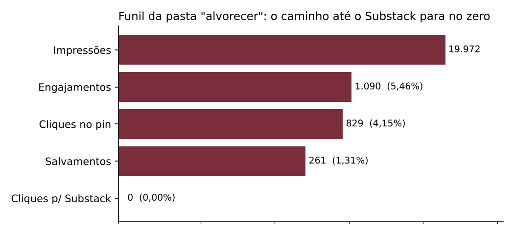
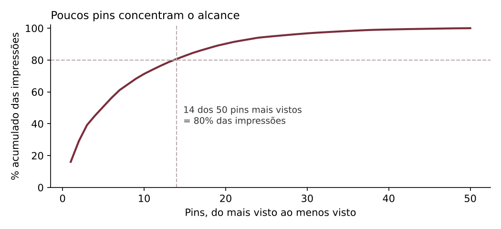
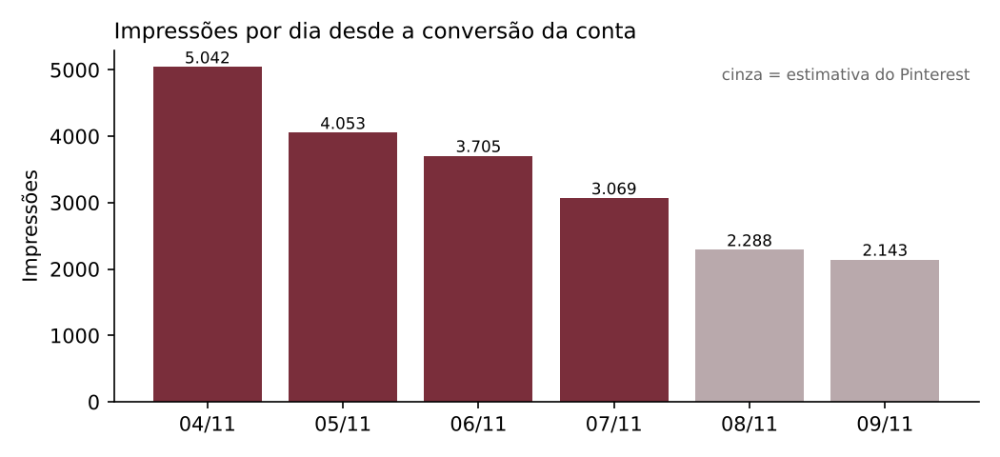
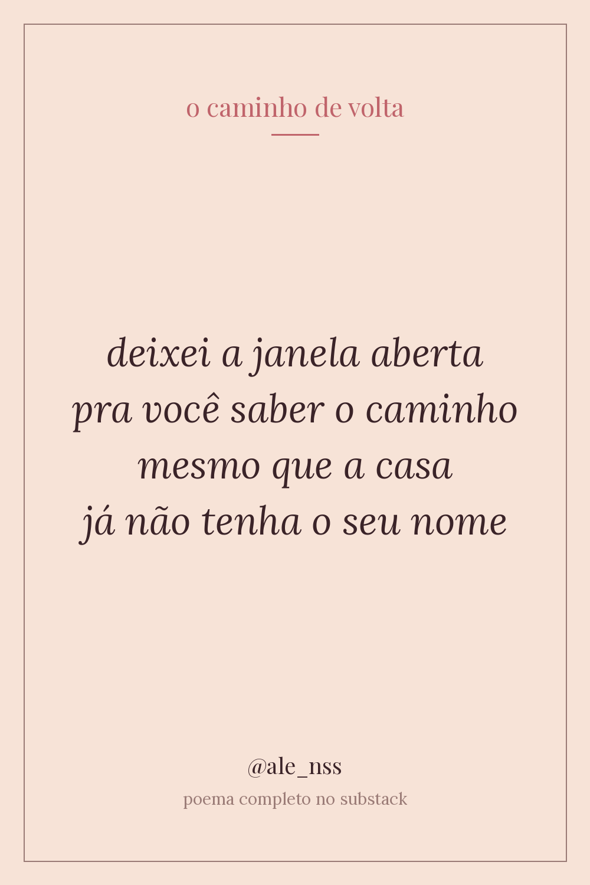

# Copiloto de distribuição de poesia

Um agente de IA que prepara cada poema meu para ser encontrado, salvo e lido. Ele cria o título, a descrição, as palavras-chave e a imagem do pin para o Pinterest, além do convite para o Substack, **sem nunca reescrever o poema**.

O projeto nasceu de um problema meu: eu escrevo e publico poesia, mas não sabia o que fazia um texto ser salvo nem por que ninguém chegava até o Substack. Tratei o projeto como um case de growth: medi o ponto de partida, encontrei o gargalo, construí a ferramenta e montei um experimento para provar se ela funciona.

> **Status:** linha de base medida (04 a 09/11/2026). Teste A/B em andamento.

---

## 1. O problema

Publico poemas no Pinterest (perfil `@ale_nss`) e os textos completos no Substack. Montar cada pin à mão (título, descrição, palavras-chave, imagem) toma tempo, e eu não tinha dados para decidir nada disso. A pergunta de negócio:

**Como fazer mais gente salvar os pins e chegar até o Substack sem perder a minha voz?**

## 2. Linha de base: o que os dados mostram

Converti a conta para conta comercial em 03/11/2026. O Pinterest só registra dados a partir da conversão, então a linha de base cobre **6 dias (04 a 09/11)**. Os dois últimos dias são estimativas que o próprio Pinterest ainda ajusta.

| Métrica | Valor |
|---|---|
| Impressões | **20.292** |
| Salvamentos | 264 (**1,30%** das impressões) |
| Cliques no pin | 839 (**4,13%**) |
| Engajamentos | 1.106 (5,45%) |
| **Cliques para o Substack** | **0** |
| Pins no ranking do export | 50 mais vistos (somam 98% das impressões) |



**Achado 1: o funil termina no zero.** Os pins geram atenção (829 cliques só na pasta principal), mas nenhum leva ao Substack. O gargalo não é alcance, é o caminho até a leitura. Por isso o copiloto sempre fecha a descrição com um convite e gera links com UTM para a versão A e a B.



**Achado 2: poucos pins carregam o alcance.** Entre os 50 pins mais vistos, 14 somam 80% das impressões, e os 5 primeiros já fazem 51%. Cada pin é uma aposta, então vale caprichar no título e no trecho de cada um, que é exatamente o que o copiloto faz.

**Achado 3: uma pasta concentra tudo.** A pasta `alvorecer` responde por 98% das impressões, com taxa de salvamento de 1,31%.



**Ponto de atenção:** as impressões diárias caíram de 5.042 para 2.143. Com só 6 dias de dados, isso pode ser efeito da distribuição inicial dos pins e não perda de interesse. Não tiro conclusão disso ainda.

A análise completa está em [`notebooks/01_linha_de_base.ipynb`](notebooks/01_linha_de_base.ipynb).

## 3. A solução

```
poema ─▶ [ copiloto (LLM) ] ─▶ títulos · descrição · palavras-chave · trechos
              ▲                              │
   guia de voz + achados dos dados           ▼
   + termos do Pinterest Trends   [ verificações em código ]
                                             │
                                             ▼
                          [ revisão de voz (2º LLM, nota 1-5) ]
                                             │
                                             ▼
               imagem do pin (template) + links com UTM + registro na planilha A/B
```

Uma interface em Streamlit junta tudo. Eu colo o poema, escolho entre as sugestões, baixo a imagem do pin e registro o par A/B na planilha do experimento com um clique.



### Decisões de produto

- **O agente não reescreve o poema.** A autoria é minha. O modelo só empacota.
- **Essa regra é garantida em código, não só no prompt.** Cada trecho sugerido para a imagem é conferido contra o texto original, e trecho que não for cópia literal é descartado. Os limites do Pinterest (100 caracteres no título, 500 na descrição) também são aplicados por código.
- **Uma segunda chamada avalia a voz.** Um revisor compara o resultado com o meu [guia de voz](prompts/guia_de_voz.md) e dá uma nota de 1 a 5.
- **O agente usa os dados.** Os achados da linha de base e os termos que anoto do Pinterest Trends entram no contexto do agente.
- **A imagem sai de um template tipográfico fixo, sem IA generativa.** Mantém a identidade visual consistente e evita imagens genéricas.
- **Tem modo demonstração.** Sem chave de API, o app funciona com regras simples, então qualquer pessoa consegue rodar.

## 4. O experimento

- **Hipótese:** pins criados com o copiloto (versão B) têm taxa de salvamento maior que pins com a minha descrição simples de sempre (versão A).
- **Desenho:** para cada poema publico dois pins no mesmo dia e horário, um A e um B, com o mesmo ID de par. Cada um leva um link de UTM próprio para o Substack.
- **Métrica principal:** salvamentos ÷ impressões. Secundárias: cliques no pin e cliques para o Substack.
- **Coleta:** métricas de cada pin anotadas entre 3 e 7 dias após a publicação em [`data/experimento.xlsx`](data/experimento.xlsx), que calcula o resumo A/B sozinha.
- **Leitura honesta:** com poucos pares, o resultado é direcional, não estatisticamente conclusivo. O objetivo é decidir se vale continuar e o que ajustar.

## 5. Como rodar

```bash
pip install -r requirements.txt
cp .env.example .env          # opcional: coloque sua ANTHROPIC_API_KEY
streamlit run app.py
pytest -q                     # 9 testes: leitura do CSV, métricas, verificações, imagem, planilha
```

Para atualizar a linha de base, exporte o CSV da visão geral do Pinterest Analytics e envie pela barra lateral do app.

## 6. Estrutura

```
app.py                      interface (Streamlit)
src/pinterest_parser.py     lê o CSV do Pinterest (várias seções empilhadas no mesmo arquivo)
src/analysis.py             métricas de linha de base e gráficos
src/copilot.py              agente, verificações e revisão de voz
src/pin_image.py            template da imagem do pin (1000×1500)
src/tracker.py              registra os pares A/B na planilha sem apagar as fórmulas
prompts/guia_de_voz.md      como eu escrevo e o que eu nunca faria
data/                       export do Pinterest e planilha do experimento
notebooks/                  análise exploratória
tests/                      testes automatizados
```

## 7. Limites e próximos passos

- **Mais dias de dados** para separar a distribuição inicial do comportamento estável.
- **Histórico do Substack** (aba própria na planilha) para cruzar tema, dia e horário com taxa de abertura.
- **Sugestão de horário** de publicação assim que houver pares A/B suficientes. Hoje não há dado por horário, e o copiloto não inventa.
- **Classificação automática de tema** de cada poema para descobrir quais temas são mais salvos.

## Por que isso importa fora da poesia

O problema é o mesmo de qualquer time de marketing: decidir **o que dizer, para quem e onde** em escala, sem perder a voz da marca, e provar com dados se funcionou. Aqui a marca é a minha escrita. O raciocínio (linha de base, gargalo, ferramenta com IA, experimento) é o mesmo para uma notificação push ou para a vitrine de um app de delivery.

---

Fontes tipográficas: Playfair Display e Lora, sob a SIL Open Font License (ver `assets/fonts/`).
